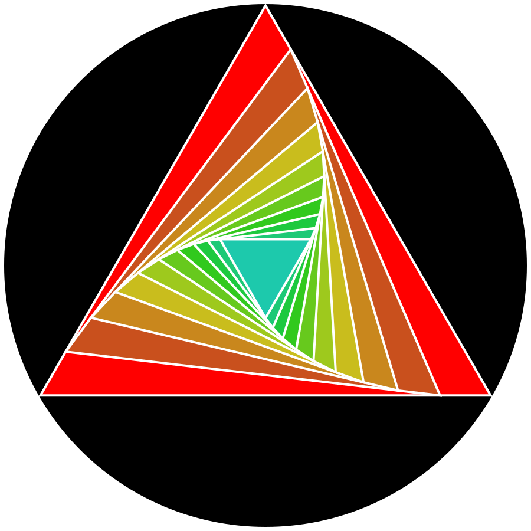

## Sports

<p><strong>Dein Training. Dein Fortschritt. Dein Obsidian-Vault.</strong></p>

<p>Plane in einer Tabelle. Erfasse deine Workouts. Mach jede Woche zählbar.</p>

<p>
  <a href="https://obsidian.md/">
    
  </a>
  <a href="https://github.com/trainvent/obsidian-sports-plugin-releases/releases/latest">
    
  </a>
</p>

<p>
  <a href="#installieren">Installieren</a> &nbsp;·&nbsp;
  <a href="#loslegen">Loslegen</a> &nbsp;·&nbsp;
  <a href="#anleitungen">Anleitungen</a> &nbsp;·&nbsp;
  <a href="#optionale-verbindungen">Verbindungen</a> &nbsp;·&nbsp;
  <a href="#hilfe-und-support">Hilfe</a> &nbsp;·&nbsp;
  <a href="README.md">English</a>
</p>

<p>Entwickelt von <a href="https://github.com/trainvent">Trainvent</a></p>

---

Sports verbindet deine **Trainingspläne, Workout-Ergebnisse, Kalender und Garmin-Aufzeichnungen**
in einem Obsidian-Dashboard, mit verknüpften Notizen für Ziele, Fortschritt
und wöchentliche Reflexion. Bring eine XLSX- oder ODS-Arbeitsmappe mit und mach sie zu deiner – von
Calisthenics und Street Workout bis Laufen, Schwimmen und anderen Sportarten.

Sports folgt der Sprache von Obsidian. Ist Obsidian auf Deutsch eingestellt, sind Oberfläche, Notizen,
Ordnernamen, Anleitungen und Vorlagen deutsch.

## Installieren

Sports ist im Verzeichnis der Community-Plugins von Obsidian verfügbar.

1. Öffne **Einstellungen → Community-Plugins → Durchsuchen**.
2. Suche nach **Sports**, wähle **Installieren** und dann **Aktivieren**.
3. Öffne **Einstellungen → Sports**, um Arbeitsmappe, Kalender oder Garmin-Verbindung einzurichten.

Erfordert **Obsidian 1.11.4 oder neuer** auf dem Desktop. Mobilgeräte werden nicht unterstützt.
Die Garmin-Anbindung ist experimentell und nutzt inoffizielle Schnittstellen.

## Was du damit machen kannst

- **Planen:** Ziele, Trainingsteile, Wochenziele und datierte Einheiten verbinden.
- **Erfassen:** Sätze, Zeiten, Runden, Zusatzgewicht und andere Messwerte in deiner Arbeitsmappe eintragen.
- **Auswerten:** Pläne und Ergebnisse vergleichen, Trainingstrends verfolgen und Wochenrückblicke schreiben.
- **Quellen zusammenführen:** Einheiten aus der Arbeitsmappe, wiederkehrende Aktivitäten, Kalendertermine und Garmin-Aufzeichnungen gemeinsam sehen.
- **Notizen behalten:** normale Markdown-Dateien mit Platz für eigene Kommentare.

Die Synchronisierung läuft **Arbeitsmappe → Obsidian**. Pläne und Ergebnisse bearbeitest du in deiner Tabelle,
Reflexionen schreibst du in Obsidian. Sports lädt nie Änderungen in deine Arbeitsmappe hoch.
Diagramme werden lokal gezeichnet, ohne weiteres Community-Plugin oder Diagrammdienst.

## Loslegen

1. Öffne **Einstellungen → Sports → Quellen → Arbeitsmappe → Einrichtung → Anleitung öffnen**. Lies
   [Arbeitsmappe.md](de/Arbeitsmappe.md), bevor du eine Datei anpasst; die Anleitung liegt auch unter
   `Anleitung/Arbeitsmappe.md` in deinem Sports-Notizordner.
2. Wähle unter **Einrichtung** die **Leere Vorlage**, um deinen eigenen Plan zu bauen, oder die **Beispiel-Arbeitsmappe**, um
   von einem ausgefüllten Plan zu lernen. Beide gibt es als **XLSX herunterladen** und **ODS herunterladen**.
3. Fülle die Datei mithilfe der Anleitung aus oder passe sie an deine Ziele, deine verfügbare Zeit, deine Ausrüstung
   und deine Sportarten an. Das kannst du selbst tun oder Datei und Anleitung
   deinem Chatbot geben. Lass künftige Ergebnisse leer.
4. Lade die fertige Datei zu Nextcloud oder einem anderen Dienst mit HTTPS-Download-Link hoch. Füge den Link unter
   **Cloud-Link zur Arbeitsmappe** ein und lass die Blattzuordnungen unter **Blätter** und **Zeitplan**
   auf **Strategie**, **Trainingstagebuch** und **Wochenplan**.
5. Wähle **Jetzt synchronisieren** und dann in der Befehlspalette **Sports: Dashboard öffnen**.
6. Erfasse Training in der Arbeitsmappe, berechne neu und speichere, falls sie Formeln verwendet,
   und synchronisiere erneut.
7. **Optional: Nutze [Calcrow](https://calcrow.com/) für alltägliche Änderungen im Blatt Trainingstagebuch.**
   Calcrow stammt von Trainvent. Speichere Änderungen in der Cloud-Arbeitsmappe, bevor du Sports synchronisierst.

## Training im Dashboard anzeigen

Für das heutige Training, anstehende Einheiten und Links zu Diese Woche, Statistik und Protokoll:

````markdown
```sports-dashboard
```
````

Nur das heutige Training:

````markdown
```sports-today
```
````

Beide funktionieren in der Leseansicht und in Live Preview. Wähle ein Datum, um seine Tagesnotiz zu öffnen,
auch an Tagen ohne Training. Siehe [Einbettungsoptionen](de/Sports-verwenden.md#training-in-eine-andere-notiz-einbetten).

## Anleitungen

| Anleitung | Wofür |
| --- | --- |
| [Arbeitsmappe](de/Arbeitsmappe.md) | Vorlage ausfüllen, Ziele und Blätter festlegen, Bewertung einrichten, Plan prüfen |
| [Erfassung](de/Erfassung.md) | Workouts erfassen, Erledigt-Status und Gewichte, eigene Trainingstagebuch-Layouts |
| [Sports verwenden](de/Sports-verwenden.md) | Notizen, Diagramme, Kalender und Garmin verbinden, Pläne abschließen oder wiederherstellen |
| [Fehlerbehebung](de/Fehlerbehebung.md) | Cloud-Links, Synchronisierungszeitpunkte, fehlende Daten, Notizkonflikte und Wiederherstellung |

Die Anleitungen liegen auch unter `Anleitung/` in deinem Sports-Notizordner. Öffne die
Arbeitsmappen-Anleitung in den Einstellungen oder jede Anleitung über die Befehlspalette. Jede Anleitung aktualisiert ihren erstellten Abschnitt
und behält deine eigenen Notizen außerhalb davon.

| Ausgangspunkt | XLSX | ODS |
| --- | --- | --- |
| Leere Vorlage | [Training-Vorlage.xlsx](templates/Training-Vorlage.xlsx) | [Training-Template.ods (Englisch)](templates/Training-Template.ods) |
| Ausgefülltes Beispiel | [Training-Beispiel.xlsx](templates/Training-Beispiel.xlsx) | [Training-Example.ods (Englisch)](templates/Training-Example.ods) |

Beide leeren Formate behalten alle fünf Blätter, Tabellen und Formatierungen; Trainingsdaten
und Zellformeln sind geleert. Das ausgefüllte Beispiel enthält einen 12-Wochen-Plan für Calisthenics
und Bewegung, fünf Übungsgruppen, Cal-Intervals und satzbasierte Intensitätsberechnungen. Die deutschen XLSX-Dateien
verwenden deutsche Blattnamen, Abschnittstitel, Spaltenüberschriften und Auswahlwerte. Sports erkennt auch die englischen Entsprechungen.
Passe das Beispiel vor dem Training an deine Bedürfnisse an.

## Optionale Verbindungen

- **Garmin:** Verbinde dich unter **Quellen → Smartwatch → Garmin**, um aufgezeichnete Aktivitäten zu importieren. Das funktioniert
  auch ohne Arbeitsmappe. Einrichtung, gespeicherte Daten und die experimentelle Coach-Option beschreibt
  [Garmin-Aktivitäten synchronisieren](de/Sports-verwenden.md#garmin-aktivitäten-synchronisieren).
- **Google Health (Fitbit, Pixel Watch):** Verbinde dich unter **Quellen → Smartwatch → Google Health** mit deinem Google-Konto. Siehe
  [Google-Health-Aktivitäten synchronisieren](de/Sports-verwenden.md#google-health-aktivitäten-synchronisieren).
- **Apple Watch und andere Uhren:** Speichere Trainings als FIT-, TCX- oder GPX-Dateien in einem freigegebenen Dropbox- oder Nextcloud-Ordner,
  zum Beispiel mit HealthFit, und füge seinen Link unter **Quellen → Smartwatch → Apple Watch und andere** ein. Siehe [Trainingsdateien](de/Sports-verwenden.md#trainingsdateien-apple-watch-und-andere-uhren).
- **Kalender:** Wähle unter **Quellen → Zeitplan** den **ICS-Kalender** für einen Trainings-Feed aus Google Calendar,
  Nextcloud oder einer anderen ICS-Quelle. Siehe [Zeitpläne und Kalender](de/Sports-verwenden.md#zeitpläne-und-kalender).

## Aktuelle Grenzen

- Nur Desktop, mit einem aktiven Plan aus einer Arbeitsmappe. Schließe den aktuellen Plan ab, bevor du einen anderen beginnst oder wiederherstellst.
- Kein Zurückschreiben in die Arbeitsmappe, kein Hochladen von Workouts auf die Uhr, kein Zurückschreiben in den Kalender und kein automatisches Coaching.
- Blattnamen sind einstellbar; beliebige Spaltenzuordnung und eine Importvorschau gibt es nicht.
- Wiederkehrende Aktivitäten folgen einem Wochenplan; Änderungen einzelner Vorkommen und Zeitzonenumrechnung des Zeitplans sind nicht umgesetzt.
- Erledigte Einheiten und verknüpfte Teilversionen sind geschützt. Entfernte erledigte Einheiten bleiben zwischengespeichert; entfernte unerledigte Zeilen verlassen den aktiven Plan.
- Konflikte in erstellten Notizen müssen manuell gelöst werden; eine Oberfläche dafür gibt es nicht.

## Datenschutz

Externe Anfragen beginnen erst, wenn du einen Cloud-Link zur Arbeitsmappe einrichtest, einen ICS-Kalender
mit Abonnementlink wählst, einen Link zum Trainingsordner einträgst oder Garmin bzw. Google Health verbindest. Google-Health-Daten werden über Googles
Health API (`health.googleapis.com`) mit reinem Lesezugriff auf Aktivitäts- und Fitnessdaten abgerufen. Die Synchronisierung von Arbeitsmappe und Trainingsordner lädt nur die eingestellte HTTPS-Quelle herunter und lädt nie etwas hoch
oder ändert sie. Freigabelinks werden in den Plugin-Einstellungen gespeichert und können jedem Zugriff geben,
der sie kennt. Die Vorlage wird als Browser-Download angeboten;
das Plugin liest und schreibt keine Dateien außerhalb des Vaults.

Importierte Trainingsdaten, Synchronisierungseinstellungen und die Grundlagen der erstellten Abschnitte werden
in den Plugin-Einstellungen im Vault gespeichert. Sie können mit deinem Vault-Synchronisierungsdienst übertragen werden.
Erstellte Notizen und Anleitungen werden über die Vault-Schnittstelle von Obsidian geschrieben.
Um Sports-Notizen wiederzufinden, die du bei ausgeschaltetem Plugin verschoben hast, prüft Sports die
Dateiliste und die von Obsidian zwischengespeicherten Eigenschaften auf seine eigenen `sports_id` und
`sports_uid`; andere Notizen liest es nicht. In die Zwischenablage schreibt es nur, wenn du eine
Kopieren-Schaltfläche wählst, und liest sie nie.
Die Dateien `settings.md` abgeschlossener Pläne behalten Link zur Arbeitsmappe, importierten Plan und
Grundlagen der erstellten Abschnitte im Archivordner. Sicherungskopien behalten den vollständigen
Notizinhalt im versteckten Plugin-Speicher. Diese Dateien können mit Vault-Synchronisierung
oder Sicherungen übertragen werden; entferne private Links und Trainingsdaten, bevor du sie teilst.
Garmin- und Google-Health-Token liegen im geschützten Speicher von Obsidian; Zugangsdaten werden nie gespeichert.
Siehe die vollständige [Datenschutzerklärung](https://sports.trainvent.com/de/privacy/) und die [Sports-Website](https://sports.trainvent.com/de/). Es werden keine
Nutzungsdaten erhoben. **Einstellungen → Kontakt** enthält einen Link zu [GitHub Sponsors](https://github.com/sponsors/leonmarq); andere Werbung gibt es nicht.

## Lizenz und Hinweise

Basiert auf dem [Obsidian sample plugin](https://github.com/obsidianmd/obsidian-sample-plugin).
Der ursprüngliche Urheberrechtshinweis und die Lizenz 0-BSD stehen in [LICENSE](LICENSE).
Lizenzen und Hinweise zu mitgelieferten Abhängigkeiten stehen in [THIRD_PARTY_NOTICES.md](THIRD_PARTY_NOTICES.md)
und im ausgelieferten `main.js`, darunter fflate, read-excel-file mit seinem auf saxen basierenden
Parser, worker-f, garminconnect-js und ical.js.

## Hilfe und Support

[Melde ein Problem](https://github.com/trainvent/obsidian-sports-plugin-releases/issues) mit
deiner Obsidian- und Sports-Version, der Fehlermeldung und den Schritten zum Nachstellen. Entferne
private Freigabelinks, Zugangsdaten und persönliche Trainingsdaten aus Anhängen.
Du kannst dich auch an den [Trainvent-Support](https://next.trainvent.com/de/software-support/) wenden
oder die [Entwicklung unterstützen](https://github.com/sponsors/trainvent).
