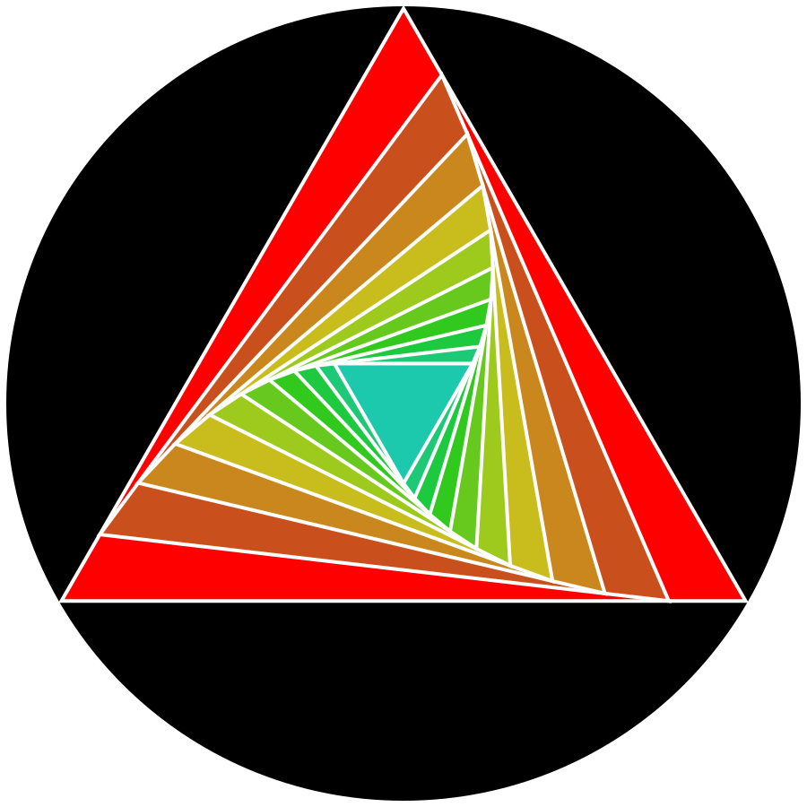

<div align="center">



<h1>Sports</h1>

<p><strong>Your training. Your progress. Your Obsidian vault.</strong></p>

<p>Plan in a spreadsheet. Track your workouts. Make every week count.</p>

<p>
  <a href="https://obsidian.md/">
    
  </a>
  <a href="https://github.com/trainvent/obsidian-sports-plugin-releases/releases/latest">
    
  </a>
  <a href="#your-notes">
    
  </a>
</p>

<p>
  <a href="#install">Install</a> &nbsp;·&nbsp;
  <a href="#get-started">Get started</a> &nbsp;·&nbsp;
  <a href="#workbook-and-tracking-guides">Workbook guides</a> &nbsp;·&nbsp;
  <a href="#calendar-subscriptions">Calendars</a> &nbsp;·&nbsp;
  <a href="#help-and-support">Get help</a>
</p>

<p>Built by <a href="https://github.com/trainvent">Trainvent</a></p>

</div>

---

Sports connects your **training plans, workout results, calendars, and Garmin
recordings** in one Obsidian dashboard, with linked notes for goals, progress,
and weekly reflections. Bring an XLSX or ODS workbook and make it your own—from
calisthenics and street workout to running, swimming, and other sports.

## Install

Sports is available in Obsidian's community plugins directory.

1. Open **Settings → Community plugins → Browse**.
2. Search for **Sports**, select **Install**, then **Enable**.
3. Open **Settings → Sports** to set up your workbook, calendar, or Garmin connection.

Requires **Obsidian 1.11.4 or later** on desktop. Mobile is not supported.
Garmin integration is experimental and uses unofficial endpoints.

## What you can do

- **Plan:** connect goals, training parts, weekly targets, and dated sessions.
- **Record:** enter sets, time, rounds, added weight, and other measurements in your workbook.
- **Review:** compare plans and results, follow training trends, and write weekly reflections.
- **Combine sources:** see workbook sessions, recurring activities, calendar events, and Garmin recordings together.
- **Keep your notes:** browse ordinary Markdown files with space for your own commentary.

Sync flows **workbook → Obsidian**. Edit plans and results in your spreadsheet;
write reflections in Obsidian. Sports never uploads changes to your workbook.
Charts render locally without another community plugin or chart service.

## Get started

1. Open **Settings → Sports → Workbook guide → Open guide**. Read
   [Workbook.md](Workbook.md) before adapting a file; it is also saved under
   `Guide/Workbook.md` in your Sports notes folder.
2. Choose **Blank template** to build your own plan or **Example workbook** to
   learn from a filled plan. Both offer **Download XLSX** and **Download ODS**.
3. Use the guide to fill or adapt the file to your goals, availability, equipment,
   and preferred activities. You can do this yourself or give the file and guide
   to your chatbot. Keep future results blank.
4. Upload the completed file to Nextcloud or another service with an HTTPS
   download link. Paste it into **Cloud workbook link** and keep the sheet
   mappings **Strategy**, **Daily**, and **Recurring**.
5. Select **Sync now**, then **Open dashboard**.
6. Record training in the workbook, recalculate and save if it uses formulas,
   then sync again.

The XLSX template is an empty copy of the full five-sheet example, retaining its
tables and formatting, with all cell formulas and cached calculation results removed.
Keep every sheet and table when filling the template. Optional features may have
empty data; remove structure only when deliberately requested. Agree on recurring
activities and scoring with your agent, then check workbook completeness using
[Workbook.md](Workbook.md#check-before-returning-the-workbook).
Both blank formats use the full five-sheet layout. The example contains a filled
12-week calisthenics plan, exercise library, section weights, and scoring. It is a worked
example to adapt, not a personalized training recommendation.

In the example, adjust the set values to what you did, clear unused sets, and
select TRUE under **Session done**. FALSE or blank leaves the prefilled targets
unrecorded. Positive Cal-Intervals rounds are recorded with Session done;
zero or blank means that circuit was not done. Enter optional kg in each section’s **Weight** field and update it before completing the session.

Enable **Show schedule** to include the selected schedule in the dashboard and
weekly notes. It is off by default; changing **Schedule source** enables it. Recurring entries describe
plans; they never prove that an activity was completed. Keep Recurring activities
out of Daily: Daily records separate manual workouts, not copies of the timetable.

Each sheet mapping is optional and accepts an exact tab name. Leave it blank to
disable that import. Garmin can be used independently by leaving all three blank.
Disabling a mapping retains previously imported data and notes.

For everyday Daily-sheet edits, you can also use [Calcrow](https://calcrow.com/),
made by Trainvent. Save changes to the cloud workbook before syncing Sports.

## Workbook and tracking guides

- [Workbook guide](Workbook.md): sheet structure, goals, schedules, scoring, loads, and safe customization.
- [Flexible tracking guide](Tracking.md): custom exercises, any number of sets, variable targets, and multiple metrics.

| Starting point | XLSX | ODS |
| --- | --- | --- |
| Blank template | [Training-Template.xlsx](templates/Training-Template.xlsx) | [Training-Template.ods](templates/Training-Template.ods) |
| Filled example | [Training-Example.xlsx](templates/Training-Example.xlsx) | [Training-Example.ods](templates/Training-Example.ods) |

The XLSX and ODS templates and filled examples include Strategy, Daily, Recurring,
Scoring and Library. Both blank templates keep the full layout without
training data or cell formulas. The example’s
exercises and five set columns are illustrations; the
importer supports custom layouts described in the guides. To adapt a workbook with a chatbot, give it a
copy and the workbook guide. Preserve recorded history and stable session IDs.

Sports reads saved formula results and does not recalculate spreadsheets.
Recalculate and save in your spreadsheet editor before syncing. Keep Library
and Scoring tab names: they are discovered automatically.
A workbook guide is copied into your notes folder; existing guide edits are preserved.
The tracking guide is also available from the dashboard and command palette.

## Your notes

The default notes folder is `Sports/`. Files are created as their source data becomes available.

| Path | Contents |
| --- | --- |
| `Overview.md` | Starting page with today, this week, and navigation |
| `Sports.base` | Sortable Weeks and Routines views over note properties |
| `Stats.md` | Source totals and training trends |
| `Weeks/YYYY-MM-DD.md` | Primary weekly planning, results, and review |
| `Structure/Plans.md` | Goals, weekly progression, and upcoming sessions |
| `Structure/Strategy.md` | Program structure and recurring schedule |
| `Structure/Calendar.md` | Upcoming workbook sessions, selected schedule, and optional Coach workouts |
| `Analytics/Log.md` | Manual results and Garmin activities, grouped by date |
| `Analytics/Sheet.md` | Planned intensity, performance, and felt-effort trends |
| `Analytics/Smartwatch.md` | Garmin volume, running, and swimming graphs |
| `Analytics/Days/_Index.md` and `Analytics/Days/YYYY-MM-DD.md` | Day index, session details, sets, and reflections |
| `Goals/<goal_id>.md` | Goal targets, mapped results, matching activities, and reviews |
| `Routines/` | Routine explanations, exercises, and progressions |
| `Guide/` | Workbook and tracking guides |

Weekly notes cover the current week, imported sessions, and Week plans.
Day notes under Analytics cover today and earlier dates with workbook or Garmin
entries, plus enabled calendar events. Start in Weeks for planning; use Analytics/Days to review recorded days.
Goal categories distinguish aspiration and maintenance; either can use workbook
results and Garmin activities. Configure their source mappings in Strategy.

### Properties and tags

Overview is the navigation hub. Other notes use properties for relationships and
shared tags for grouping, with direct links beside the content they refer to.

| Note | Properties |
| --- | --- |
| Goal | `goal_id`, `category`, `garmin_types` |
| Routine | `targets`: links to its goal notes |
| Day | `date`, `week`: link to its weekly note |
| Week | `week_start`, `week_end`, `program_week`, `phase` |

Empty optional properties are omitted. Sync maintains these properties from
imported data; edit their source in the workbook. Unrelated custom properties
are preserved. Benchmarks, workouts, results, and reflections stay in the body.

Shared tags include `sports/planning`, `sports/goals`, `sports/training`, and
`sports/analytics`. Running and swimming routines and matching goals also receive
sport tags. Sports refreshes its own tag groups while preserving custom tags.
See the [full tag map and property example](Workbook.md#properties-and-tags).

### Browse weeks and routines

Select **Browse weeks and routines** in Overview to open `Sports.base`. Its
**Weeks** view shows dates, program week and phase; **Routines** shows linked goals.
Enable Obsidian's **Bases** core plugin to use these sortable tables. Only notes
in your current Sports folder are included; backups and the routine index are excluded.

The base reads existing properties and needs no separate sync. Customize its
columns, sorting and filters freely: Sports creates the file only when missing
and preserves existing base files. Workbook-managed property edits made through
a base are still replaced on sync. Edit the workbook to change those values.

### Add today to another note

Paste this fenced block into your dashboard note:

````markdown
```sports-today
```
````

It shows today's sessions, Garmin activities, the enabled schedule, and
a link to the weekly note in Reading view or Live Preview.

## Sync and cloud links

Use an HTTPS link to the XLSX or ODS file itself. Nextcloud file-share links such
as `https://cloud.example/s/SHARE_TOKEN` work; Sports adds `/download` automatically.
The link must allow downloads without a login or password. Folder shares,
spreadsheet editor URLs, local paths, and encrypted workbooks are unsupported.
Downloads are limited to **5 MB** and **30 seconds**, with redirects restricted
to the same HTTPS server.

Startup sync is enabled and the default interval is ten minutes. Choose five,
ten, or fifteen minutes, one hour, or **Manual only** in settings. Startup sync
has its own toggle. Automatic sync runs while Obsidian is open; closed apps and
suspension stop or delay it. Garmin automatic refresh runs at most hourly.
Failed downloads or invalid imports retain the previous dataset.

## Calendar subscriptions

In **Sports settings → Schedule**, select **ICS calendar** as the schedule source and add an ICS subscription link from a dedicated training calendar, then select **Sync now**. For Google Calendar, use the calendar’s secret address in iCal format. For Nextcloud, paste the public calendar share link or an ICS subscription/export link. Public calendar share links are converted to ICS exports automatically; private CalDAV URLs requiring login are not supported. HTTPS and `webcal://` links are supported (`webcal` is downloaded over HTTPS).

Choose either **Workbook weekly schedule** or **ICS calendar**. The inactive source is not synchronized or displayed; workbook strategy and training logs remain available with either choice.

Calendar events appear in the dashboard, Today widget, Calendar note and weekly notes. Refresh uses **Sync on startup** and **Sync interval**. Changes and deletions replace the cached calendar events after a successful download; failed downloads retain the previous cache. ICS is read-only: create, move and delete events in Google Calendar or Nextcloud. It does not mark workouts completed or change the workbook.

Each refresh imports event start dates from the past 30 days through the next 365 days, including recurring events and exceptions. Timed events use the device’s timezone; all-day events retain their calendar date. Multi-day events appear on their starting day. Dates beyond this window require a later refresh. Feeds are limited to 5 MB and recurrence expansion to 50,000 occurrences per refresh.

The subscription URL and imported event details are stored locally in the vault’s plugin data and may be copied by vault sync or backups. Treat a secret subscription link like a password. Requests go directly to the configured calendar provider; no vault data is uploaded. Clear the link and sync to disconnect and remove imported events from generated notes. Generated notes follow the usual edit-protection rules.

### Calendar plans and Garmin recordings

Weekly notes, daily notes, the dashboard and the Today widget group a Garmin activity inside its scheduled workout tile when the sport is compatible and the recording substantially overlaps the planned time. For example, an 08:00–09:00 swim can contain an 08:10–09:00 Garmin recording. The tile keeps planned minutes and recorded measurements separate. Unmatched activities get their own tiles; equally plausible matches remain separate. All-day events and entries without a duration are not matched automatically.

Matching supports both ICS calendar events and the workbook’s weekly schedule. Links are recalculated from the current source data after refresh; they do not edit the calendar, Garmin records, manual completion, or analytics totals. Several recordings can belong to one planned event, but a recording is shown only once. Existing note edits and reflections keep their usual protections.

### Calendar goal links

Add a line to an event’s description to associate it with a Strategy goal:

```text
goal-id: swimming
```

Use the exact `goal_id` from Strategy, rather than its display title. Multiple goals use `goal-ids: swimming, running`. The event appears on that goal’s page and in routines connected to it through Strategy’s part-to-goal links or Garmin type mapping. For example, a custom goal with Garmin types `swimming` feeds **Routines/Swimming**. These links also help match Garmin recordings when an event has a generic title such as “Morning practice.”

Exact Strategy goal IDs in descriptions also work without a label: `swimming` or `Tsve swimming`. IDs must stand alone, separated by whitespace, commas or semicolons; partial words are not matched. A labelled `goal-id:` takes priority. Only these IDs route calendar events to goals and routines. Event titles and goal display titles can use any language; descriptions without a known ID stay unassigned. Events remain visible in the main calendar regardless. The key line is hidden in workout tiles. On routine and goal pages, matching recordings share the event’s dated table row. Weekly and daily notes keep them inside the event tile.

### Compact sport pages and templates

Routine and goal pages use compact tables. **Recurring schedule** lists each calendar series once with its weekdays, time and recurrence. **Dated sessions** contains one-off events, moved occurrences, and recorded sessions; a linked Garmin recording stays on its planned event’s row. Unrecorded recurring occurrences are not repeated as dated rows. Weekly and daily notes retain their workout tiles.

Sports creates an editable **Templates/Sport entries.md** inside the Sports notes folder. Open it with **Sports: Open sport entry template**. Use it with Obsidian’s core Templates plugin to start your own sport notes; if your Templates folder is elsewhere, copy it there. Existing template edits are preserved. Keep personal entries outside the plugin’s generated sections.

## Finish a plan

Select **Finish plan** in the dashboard or Sports settings. The destination defaults
to `Archive/<plan name>` and can be changed. **Finish and move notes** moves the
current notes there, disconnects the workbook, and clears the active plan.

Each finished folder includes `settings.md`, which keeps its original workbook
link, sheet names, imported plan, and generated-note baselines. These saved plans
are separate from the 10 rotating recovery copies and do not expire automatically.
The workbook itself, Garmin connection, and plugin preferences are retained.

In Sports settings, select **Restore from folder**, enter the finished folder,
and select **Read saved plan**. You can copy its workbook link without restoring.
**Restore plan** moves the notes back and restores the saved plan and link.
Finish any active plan first; existing destination folders are never overwritten.
Workbook sync stays paused until you select **Sync now**, so you can inspect or
replace the recovered link first. To start a new plan instead, select a workbook.

## Notes and recovery

Sports uses hidden `sports:begin` / `sports:end` comments to identify generated
sections. Keep the markers and write reflections outside them. They appear in
source mode and stay hidden in Reading view. Edited generated content or damaged
markers cause a conflict; other notes can still update.

Choose the recovery action that matches the problem:

| Situation | Action |
| --- | --- |
| Refresh notes from the last import | **Generate notes from imported data** |
| A generated note was deleted | **Recreate missing notes** |
| A generated section was edited | Move personal changes outside it, restore the previous generated section, then refresh |
| Rebuild generated sections after persistent sync-state problems | **Clear cached data**, then **Sync now** |

A cache reset keeps settings and note files, but clears imported workbook, calendar, and Garmin
data and saved generated-section baselines. Existing target notes are backed up
in hidden plugin storage before their generated sections
are rebuilt. Reflections outside those sections and unrelated properties stay in
place. Changes inside a rebuilt section survive in its backup, not in the new output.

Recovery remembers pending notes across refreshes, including Garmin-backed day
and historical week notes that return after the workbook refresh. You do not need
to reset again just because one source returns later. Missing or damaged markers
still need repair; a reset does not bypass those checks. Results absent from both
the workbook and Garmin cannot be restored by syncing.

Backups are recovery copies, not active notes or sync inputs. Normal sync does
not create them. At most 10 recovery copies are retained; each new copy replaces
the oldest when storage is full.
Keep managed note filenames stable.
See [the workbook guide](Workbook.md#sync-recovery) for recovery details.

## Training charts

Exercise comparisons show explicit targets and recorded results, with each unit
kept separate. Blank results remain missing; zero remains a recorded value.

The example's Scoring sheet supplies planned intensity (0–10), target attainment
as performance (%), and coverage. Optional **Effort rating** (1–5) records how
hard the session felt. These are separate measurements. The workbook guide explains
the chart scales and calculation inputs in [Workbook.md](Workbook.md#scoring-and-the-analytics-folder).

Stats keeps workbook and Garmin totals separate. Smartwatch charts show weekly
recorded minutes, running pace, swimming pace, heart rate, and available zone data.
Garmin activities never complete a manual session automatically.

## Garmin activity sync

On desktop, select **Settings → Sports → Connect Garmin**. Sign in with your
Garmin email and password, then enter the verification code if requested. No Python,
terminal commands or separate installation are required. This connection is experimental
until sign-in, MFA and token refresh have been checked with a live account.

Connecting explicitly enables network access to Garmin and starts an activity import.
Passwords and verification codes are held only in the sign-in dialog and are never
saved. Session tokens are saved through Obsidian's secret storage, separately from
plugin settings and generated notes. Obsidian 1.11.4 or later is required.

The bundled [garminconnect-js](https://github.com/DynamicsNinja/garminconnect-js)
client uses unofficial Garmin Connect endpoints. It also downloads public OAuth
application keys from `https://thegarth.s3.amazonaws.com/oauth_consumer.json`; no
credentials or activity data are sent to that host. This is JSON data, not remote
executable code. Garmin can change these endpoints or limit sign-ins. This feature
currently supports Garmin accounts on garmin.com, not garmin.cn.

Set **Garmin history start** to the first date to import. The initial default is 90
days ago. While Obsidian runs, automatic sync checks Garmin at most once an hour,
using the configured sync timer. **Sync now** requests an immediate refresh.
Garmin refreshes independently when workbook import fails. With all three workbook sheet
mappings blank, it can also run without a workbook.

Activity ID, local date/time, name, type, duration, distance, average heart
rate and heart-rate zone summaries are cached in the vault's plugin data and shown in **Log**, weekly notes and the
dashboard. No GPS routes or complete account responses are retained. Activities use
Garmin's local start time; GMT-only records use the plan's timezone, or your local
timezone without a plan. Garmin records never mark manual sessions complete.

Each successful refresh replaces the selected date range, so activity edits and
deletions do not create duplicates. On failure the previous snapshot remains visible
with a warning. **Disconnect** clears the saved tokens and stops Garmin requests;
cached activities remain available. **Clear cached data** removes the imported
activity cache while keeping connection settings. Generated notes and reflections
keep their existing edit protection.

### Optional Garmin Coach plans

Enable **Show Garmin Coach plans** to include published adaptive Coach workout
summaries for the next 28 days in Plans and Calendar. This is off by default and
still needs live-account verification. Full workout steps, self-scheduled workouts,
and static training plans are excluded. Check Garmin Connect for the current prescription.
Failed refreshes retain cached summaries with a warning. Turning the setting off
stops Coach requests; disconnecting stops all Garmin requests.

## Current limits

- Desktop only, with one active workbook plan. Finish the current plan before starting or restoring another.
- No workbook write-back, watch workout uploads, calendar write-back, or automatic coaching.
- Sheet names are configurable; arbitrary column mapping and import previews are not available.
- Recurring activities use a weekly schedule; per-occurrence edits and schedule-timezone conversion are not implemented.
- Completed sessions and linked part versions are protected. Removed completed sessions remain cached; removed unfinished rows leave the active plan.
- Generated-note conflicts require manual recovery; there is no conflict-resolution interface.

Development is maintained in a separate private repository.

## Privacy

External requests start after you configure a cloud workbook link, select an ICS
calendar with a subscription link, or connect Garmin. Workbook sync downloads only the configured HTTPS source and never uploads
or edits it. The share URL is saved in plugin settings and may grant access to
anyone with the link. The generated template is offered as a browser download;
the plugin does not read or write files outside the vault.

Imported training data, sync preferences, and generated-block baselines are stored
in vault-local plugin settings. These may travel with your vault sync provider.
Generated notes and the workbook guide are written through Obsidian's vault API.
Finished-plan `settings.md` files retain the workbook link, imported plan, and
generated-section baselines in the archive folder. Recovery copies retain full
note contents in hidden plugin storage. These files may travel with vault sync
or backups; remove private links and training data before sharing them.
Garmin tokens use Obsidian secret storage; credentials are never saved. No
telemetry is collected. Plugin settings and compiled output are excluded from
version control.

## License and attribution

Based on the [Obsidian sample plugin](https://github.com/obsidianmd/obsidian-sample-plugin).
The original copyright notice and 0-BSD license are retained in [LICENSE](LICENSE).
Bundled dependency licenses and attribution are in [THIRD_PARTY_NOTICES.md](THIRD_PARTY_NOTICES.md)
and included in the distributed `main.js`, including fflate, read-excel-file, its
saxen-derived parser, worker-f, garminconnect-js, and ical.js.

## Help and support

[Report an issue](https://github.com/trainvent/obsidian-sports-plugin-releases/issues) with
your Obsidian and Sports versions, the error, and steps to reproduce it. Remove
private share links, credentials, and personal training data from attachments.
You can also use [Trainvent support](https://next.trainvent.com/de/software-support/)
or [sponsor development](https://github.com/sponsors/trainvent).
